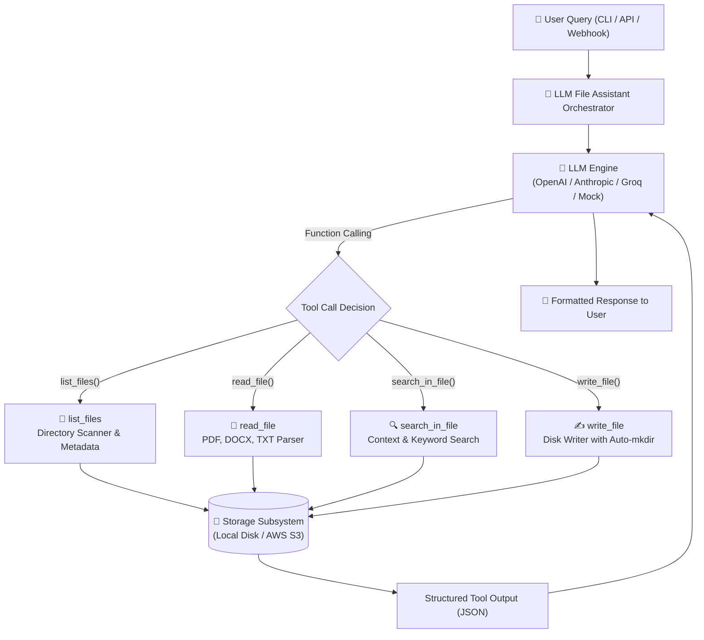
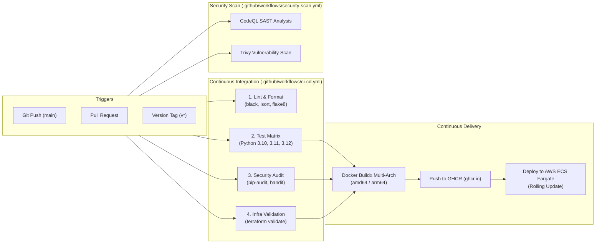
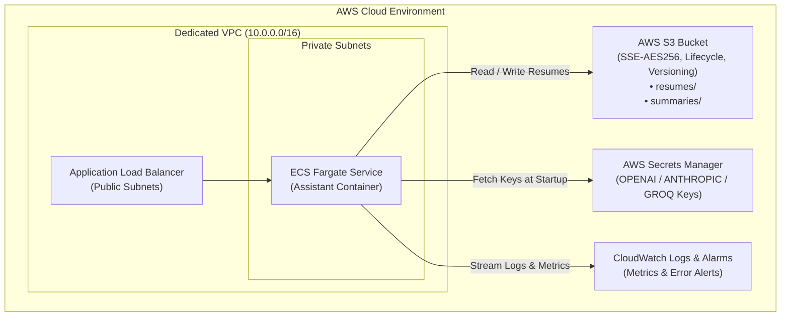

# 📂 LLM-Powered File System Assistant

[](https://github.com/Shubhankart101/LLM-PoweredFileSystemAssistant/actions/workflows/ci-cd.yml)
[](https://github.com/Shubhankart101/LLM-PoweredFileSystemAssistant/actions/workflows/security-scan.yml)
[](infra/terraform)
[](Dockerfile)
[](requirements.txt)
[](tests/)

An enterprise-ready, autonomous file system assistant powered by Large Language Models (LLMs) with structured function calling. It inspects local and cloud directories, parses diverse document formats (PDF, DOCX, TXT), performs case-insensitive keyword searches with surrounding line context, and generates structured document summaries directly onto the filesystem.

Includes a complete **CI/CD pipeline**, **Infrastructure as Code (Terraform)** for AWS cloud deployment, **Docker containerization**, and a modular **Documentation Hub** under [`docs/`](docs/).

---

## 📚 Table of Contents

- [🎯 Learning Objectives & Highlights](#-learning-objectives--highlights)
- [🏗️ System Architecture & Workflow](#️-system-architecture--workflow)
- [🔄 CI/CD Pipeline Architecture](#-cicd-pipeline-architecture)
- [☁️ Cloud Infrastructure Deployment (IaC)](#️-cloud-infrastructure-deployment-iac)
- [📖 Documentation Hub (`docs/`)](#-documentation-hub-docs)
- [📁 Project Structure](#-project-structure)
- [🚀 Quickstart & Installation](#-quickstart--installation)
- [🐳 Docker & Container Deployment](#-docker--container-deployment)
- [💻 Usage & CLI Modes](#-usage--cli-modes)
- [🛠️ Core Tools Reference (`fs_tools.py`)](#️-core-tools-reference-fs_toolspy)
- [🧪 Automated Testing](#-automated-testing)
- [🎥 Demo Video Guide (2-3 Minutes)](#-demo-video-guide-2-3-minutes)

---

## 🎯 Learning Objectives & Highlights

- **LLM Function Calling / Tool Use**: Implements OpenAI & Anthropic-compatible tool specifications (`tools=[{"type": "function", ...}]`) with multi-step iterative tool execution.
- **Structured Tool Interfaces**: Type-annotated, standardized Python tools returning predictable dictionaries and lists.
- **Multi-Format Document Parsing**: Native extraction of text content and metadata from **PDF** (`pypdf`), **DOCX** (`python-docx`), and **TXT** files.
- **Robust Error Handling**: Gracefully handles missing files, permission anomalies, non-existent directories, and API fallbacks.
- **Multi-Provider Support**: Compatible with **OpenAI** (`gpt-4o-mini`), **Anthropic** (`claude-3-5-sonnet-latest`), **Groq** (`llama-3.3-70b-versatile`), and an included **Deterministic Mock Engine** for 100% offline evaluation without API keys.
- **Cloud & DevOps Ready**: Production multi-stage `Dockerfile`, `docker-compose.yml`, GitHub Actions CI/CD with security scanning, and modular Terraform configurations for AWS ECS Fargate, S3, Secrets Manager, and CloudWatch.

---

## 🏗️ System Architecture & Workflow



---

## 🔄 CI/CD Pipeline Architecture

The application includes automated GitHub Actions pipelines implementing quality gates, testing matrices, security scans, container builds, and infrastructure validation:



Detailed workflow breakdown and configuration: [`docs/ci_cd_pipeline.md`](docs/ci_cd_pipeline.md).

---

## ☁️ Cloud Infrastructure Deployment (IaC)

Enterprise-grade modular Terraform infrastructure located in [`infra/terraform/`](infra/terraform/):



- **Storage**: S3 dual-folder bucket with SSE-AES256 encryption, versioning, and lifecycle policies (transitions to Standard-IA at 30 days, Glacier at 90 days).
- **Secrets Management**: AWS Secrets Manager prevents API keys from ever being exposed in code or Git.
- **Compute**: AWS ECS Fargate cluster with rolling deployments, health checks, and autoscaling.
- **Networking**: Custom VPC with public subnets, private subnets, security groups, and an Application Load Balancer.
- **Monitoring**: CloudWatch log group, error rate metric filters, and automated alarms.

Detailed infrastructure specifications: [`docs/infrastructure.md`](docs/infrastructure.md) and [`infra/terraform/README.md`](infra/terraform/README.md).

---

## 📖 Documentation Hub (`docs/`)

Explore the in-depth documentation suite:

| Document | Description |
|---|---|
| 📘 [`docs/README.md`](docs/README.md) | **Central Documentation Hub**: Overview, reading paths by role, and navigation index. |
| 🏗️ [`docs/architecture.md`](docs/architecture.md) | **Architecture Guide**: Detailed component breakdown, ReAct loop, tool calling sequence diagrams, and security model. |
| ☁️ [`docs/infrastructure.md`](docs/infrastructure.md) | **Cloud Infrastructure**: AWS reference topology, Terraform modules, IAM least-privilege policies, and CloudWatch metrics. |
| 🔄 [`docs/ci_cd_pipeline.md`](docs/ci_cd_pipeline.md) | **CI/CD Pipeline**: GitHub Actions workflows, test matrices, SAST scanning, container buildx caching, and release automation. |
| 📑 [`docs/api_reference.md`](docs/api_reference.md) | **API Reference**: Tool input schemas, return object types, format metadata, error models, and Python SDK contracts. |
| 🚀 [`docs/deployment_guide.md`](docs/deployment_guide.md) | **Deployment Guide**: Step-by-step local bare-metal, Docker Compose, AWS ECS Fargate deployment, and operational runbook. |

---

## 📁 Project Structure

```
LLM-PoweredFileSystemAssistant/
│
├── fs_tools.py                  # Part A: Core File System Tools (read, list, write, search)
├── llm_file_assistant.py        # Part B: Autonomous LLM Assistant with function calling loop
├── create_sample_resumes.py     # Generator for realistic sample resumes (PDF, DOCX, TXT)
├── demo.py                      # Interactive/automated live demo script (ideal for video recording)
├── requirements.txt             # Python dependencies
├── pytest.ini                   # Pytest configuration
├── .env.example                 # Environment variables template
├── README.md                    # Main repository documentation
│
├── Dockerfile                   # Multi-stage production container build (non-root appuser)
├── .dockerignore                # Production container build exclusions
├── docker-compose.yml           # Local multi-service container orchestration
│
├── .github/
│   └── workflows/
│       ├── ci-cd.yml            # Lint, test matrix, security audit, Docker build, Terraform validate
│       └── security-scan.yml    # CodeQL SAST and Trivy vulnerability scanner
│
├── infra/
│   └── terraform/               # Modular Infrastructure as Code
│       ├── main.tf              # AWS resources (VPC, ECS Fargate, S3, Secrets Manager, ALB, CloudWatch)
│       ├── variables.tf         # Strongly-typed input variables
│       ├── outputs.tf           # Exported identifiers and endpoints
│       ├── backend.tf           # Remote state S3 and DynamoDB lock configuration
│       ├── terraform.tfvars.example # Sample dev and prod parameters
│       └── README.md            # Terraform execution walkthrough
│
├── docs/                        # Complete Documentation Hub
│   ├── README.md                # Documentation index and architecture overview
│   ├── architecture.md          # Detailed architecture, sequence diagrams, and data flows
│   ├── infrastructure.md        # Cloud architecture, IAM security, and monitoring
│   ├── ci_cd_pipeline.md        # Pipeline stages, security gates, and release rules
│   ├── api_reference.md         # Exhaustive tool schemas, return types, and SDK reference
│   └── deployment_guide.md      # Local Docker, staging, and AWS production runbook
│
├── resumes/                     # 8 realistic candidate resumes across PDF, DOCX, and TXT
│   ├── resume_john_doe.pdf      # Senior Python Backend Engineer (PDF)
│   ├── resume_alice_smith.pdf   # Lead Data Scientist & ML Engineer (PDF)
│   ├── resume_michael_brown.pdf # AI Systems Engineer (PDF)
│   ├── resume_bob_kumar.docx    # Full Stack Engineer (DOCX)
│   ├── resume_emily_chen.docx   # Senior Technical Product Manager (DOCX)
│   ├── resume_priya_sharma.docx # Staff Backend Engineer (DOCX)
│   ├── resume_david_wilson.txt  # DevOps & Cloud Infrastructure (TXT)
│   └── resume_sarah_connor.txt  # Lead UI/UX Frontend Engineer (TXT)
│
├── summaries/                   # Output folder created dynamically by write_file
│   └── summary_john_doe.txt     # Generated candidate summary report
│
└── tests/                       # Unit & integration test suite (24 tests)
    ├── test_fs_tools.py         # Unit tests for core file system tools
    └── test_llm_assistant.py    # Integration tests for LLM tool calling
```

---

## 🚀 Quickstart & Installation

### 1. Prerequisites
- Python 3.10+ (tested on Python 3.10, 3.11, 3.12, and 3.14)
- Git
- Docker (optional, for containerized run)

### 2. Clone Repository & Setup Virtual Environment
```bash
git clone https://github.com/Shubhankart101/LLM-PoweredFileSystemAssistant.git
cd LLM-PoweredFileSystemAssistant

# Create virtual environment
python -m venv venv

# Activate virtual environment
# Windows (PowerShell):
.\venv\Scripts\Activate.ps1
# Linux / macOS:
source venv/bin/activate
```

### 3. Install Dependencies
```bash
pip install -r requirements.txt
```

### 4. Configure Environment (Optional)
If you want to use live LLMs (OpenAI, Anthropic, or Groq), copy `.env.example` to `.env`:
```bash
cp .env.example .env
```
Edit `.env` with your API key:
```env
OPENAI_API_KEY=sk-...
# OR
ANTHROPIC_API_KEY=sk-ant-...
# OR
GROQ_API_KEY=gsk_...
```
> **Note**: If no API key is configured, the assistant automatically switches to **Mock Engine**, executing deterministic tool-calling workflows for 100% offline functionality.

### 5. Generate Sample Resumes (Already generated in `resumes/`)
To regenerate fresh sample resumes at any time:
```bash
python create_sample_resumes.py
```

---

## 🐳 Docker & Container Deployment

### Run via Docker Compose (Recommended)
```bash
# Build and run the assistant interactively
docker compose run --rm assistant

# Execute the automated benchmark demo in a container
docker compose --profile demo run --rm demo
```

### Build and Run Standalone Docker Image
```bash
# Build production image
docker build -t llm-filesystem-assistant:latest .

# Run single query
docker run --rm -v ${PWD}/resumes:/app/resumes:ro -v ${PWD}/summaries:/app/summaries:rw \
  llm-filesystem-assistant:latest "Find resumes mentioning Python experience"
```

---

## 💻 Usage & CLI Modes

### A. Guided Live Demo (Best for video recording)
Run the guided demo script with step-by-step pauses and visual banners:
```bash
# Interactive mode (pauses for commentary during recording)
python demo.py

# Continuous automatic mode
python demo.py --auto
```

### B. Interactive Assistant Mode
Chat with the assistant in real-time in the terminal:
```bash
python llm_file_assistant.py --interactive
```

### C. Direct Single-Query Execution
Pass queries directly via CLI arguments:
```bash
# Benchmark Query 1: Directory Exploration
python llm_file_assistant.py "Read all resumes in the resumes folder"

# Benchmark Query 2: Candidate Search
python llm_file_assistant.py "Find resumes mentioning Python experience"

# Benchmark Query 3: Multi-Step Summarization
python llm_file_assistant.py "Create a summary file for resume_john_doe.pdf"
```

---

## 🛠️ Core Tools Reference (`fs_tools.py`)

### 1. `read_file(filepath: str) -> dict`
Extracts text and metadata from PDF, DOCX, or TXT documents.
```python
import fs_tools

result = fs_tools.read_file("resumes/resume_john_doe.pdf")
# Returns:
# {
#   "success": True,
#   "filepath": "C:/.../resumes/resume_john_doe.pdf",
#   "filename": "resume_john_doe.pdf",
#   "extension": ".pdf",
#   "content": "John Doe\nSenior Python Backend Engineer...",
#   "metadata": {
#       "name": "resume_john_doe.pdf",
#       "size": 2964,
#       "size_bytes": 2964,
#       "size_kb": 2.89,
#       "modified_date": "2026-11-24 23:56:56",
#       "page_count": 1,
#       "word_count": 201
#   },
#   "error": None
# }
```

### 2. `list_files(directory: str, extension: str = None) -> list`
Lists files in a target directory with metadata, with optional extension filter.
```python
# List all PDF files
pdf_files = fs_tools.list_files("resumes", extension=".pdf")
# Returns list of dicts with: name, size, modified_date, size_bytes, size_kb, filepath, extension
```

### 3. `write_file(filepath: str, content: str) -> dict`
Writes string content to disk, automatically creating parent directories if they do not exist.
```python
res = fs_tools.write_file("summaries/report.txt", "Candidate Summary Report...")
# Returns: {"status": "success", "success": True, "bytes_written": ..., "filepath": ..., "message": ...}
```

### 4. `search_in_file(filepath: str, keyword: str, context_lines: int = 1) -> dict`
Performs case-insensitive search across PDF, DOCX, or TXT documents with surrounding line context.
```python
matches = fs_tools.search_in_file("resumes/resume_john_doe.pdf", "FastAPI")
# Returns: {"success": True, "matches_count": 3, "matches": [{"line_number": 5, "line_content": "...", "context": "..."}]}
```

---

## 🧪 Automated Testing

A comprehensive test suite with 24 unit & integration tests is provided:
```bash
pytest
```

Output:
```
============================= test session starts =============================
tests/test_fs_tools.py::TestListFiles::test_list_all_files PASSED        [  4%]
tests/test_fs_tools.py::TestListFiles::test_filter_by_extension_with_dot PASSED [  8%]
tests/test_fs_tools.py::TestListFiles::test_filter_by_extension_without_dot PASSED [ 12%]
tests/test_fs_tools.py::TestListFiles::test_filter_txt_files PASSED      [ 16%]
tests/test_fs_tools.py::TestListFiles::test_nonexistent_directory PASSED [ 20%]
tests/test_fs_tools.py::TestReadFile::test_read_pdf_file PASSED          [ 25%]
tests/test_fs_tools.py::TestReadFile::test_read_docx_file PASSED         [ 29%]
tests/test_fs_tools.py::TestReadFile::test_read_txt_file PASSED          [ 33%]
tests/test_fs_tools.py::TestReadFile::test_read_nonexistent_file PASSED  [ 37%]
tests/test_fs_tools.py::TestWriteFile::test_write_and_auto_create_directories PASSED [ 41%]
tests/test_fs_tools.py::TestWriteFile::test_overwrite_existing_file PASSED [ 45%]
tests/test_fs_tools.py::TestSearchInFile::test_case_insensitive_search PASSED [ 50%]
tests/test_fs_tools.py::TestSearchInFile::test_search_context_window PASSED [ 54%]
tests/test_fs_tools.py::TestSearchInFile::test_search_nonexistent_keyword PASSED [ 58%]
tests/test_fs_tools.py::TestSearchInFile::test_search_empty_keyword PASSED [ 62%]
tests/test_llm_assistant.py::TestLLMAssistantSchemas::test_tool_definitions_schema PASSED [ 66%]
tests/test_llm_assistant.py::TestLLMAssistantSchemas::test_tool_map_matches_definitions PASSED [ 70%]
tests/test_llm_assistant.py::TestLLMAssistantExecution::test_provider_initialization_mock PASSED [ 75%]
tests/test_llm_assistant.py::TestLLMAssistantExecution::test_provider_initialization_anthropic_fallback_without_key PASSED [ 79%]
tests/test_llm_assistant.py::TestLLMAssistantExecution::test_tool_dispatch PASSED [ 83%]
tests/test_llm_assistant.py::TestLLMAssistantExecution::test_invalid_tool_dispatch PASSED [ 87%]
tests/test_llm_assistant.py::TestLLMAssistantExecution::test_query_read_all_resumes PASSED [ 91%]
tests/test_llm_assistant.py::TestLLMAssistantExecution::test_query_find_python_resumes PASSED [ 95%]
tests/test_llm_assistant.py::TestLLMAssistantExecution::test_query_create_summary_file PASSED [100%]

============================= 24 passed in 0.40s ==============================
```

---

## 🎥 Demo Video Guide (2-3 Minutes)

Follow this structured script when recording your submission video:

| Time | Section | Action & Command | What to Explain |
|---|---|---|---|
| **0:00 - 0:30** | **Introduction & Overview** | Show VS Code project structure | Introduce the project, learning objectives, 4 core tools in `fs_tools.py`, and the `docs/` documentation hub. |
| **0:30 - 1:00** | **Core Tools Demo** | Run `python demo.py` | Point out the 8 sample resumes in `resumes/` across PDF, DOCX, and TXT. Show text and metadata extraction. |
| **1:00 - 1:40** | **Tool Calling: Query 1 & 2** | Step through Queries 1 & 2 | Point out the `[Tool Call]` traces: `list_files`, then `search_in_file`. Highlight how candidates with Python are found while non-Python resumes (e.g. Product Manager, Frontend) are filtered out. |
| **1:40 - 2:10** | **Tool Calling: Query 3** | Step through Query 3 | Show multi-step execution: reading `resume_john_doe.pdf`, synthesizing the summary, and calling `write_file` to save `summaries/summary_john_doe.txt`. Open the generated summary file. |
| **2:10 - 2:30** | **CI/CD & Infrastructure** | Show `.github/workflows/ci-cd.yml` and `infra/terraform/` | Explain the CI/CD pipeline, Docker containerization, and AWS Terraform infrastructure. |
| **2:30 - 2:45** | **Test Suite** | Run `pytest` | Show all 24 automated tests passing cleanly. Conclude the video. |
