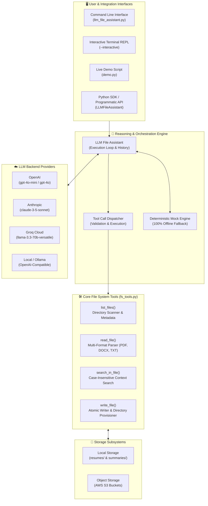

# 📂 LLM-Powered File System Assistant — Documentation Hub

Welcome to the comprehensive technical documentation for the **LLM-Powered File System Assistant**. This repository delivers an autonomous, production-grade AI assistant that interfaces directly with local and cloud file systems to inspect directories, extract text from heterogeneous documents (**PDF**, **DOCX**, **TXT**), conduct contextual keyword searches, and author structured summary deliverables.

---

## 📑 Documentation Index

| Document | Primary Focus | Target Audience |
| :--- | :--- | :--- |
| [Architecture & System Design](architecture.md) | Multi-step tool-calling pipelines, system components, sequence diagrams, data flow, error recovery | Architects, Engineers, AI Researchers |
| [Infrastructure as Code (Terraform)](infrastructure.md) | AWS cloud architecture, S3 storage layout, KMS encryption, Secrets Manager, least-privilege IAM, CloudWatch | DevOps, Cloud Engineers, SREs |
| [CI/CD Pipeline](ci_cd_pipeline.md) | GitHub Actions automation, linting, testing, security vulnerability scans (Bandit/Trivy), container builds, deployment gates | DevOps Engineers, QA, Developers |
| [API Reference](api_reference.md) | Comprehensive tool schemas (`read_file`, `list_files`, `write_file`, `search_in_file`), JSON schemas, LLM assistant SDK, error codes | Integration Developers, Client Authors |
| [Deployment Guide](deployment_guide.md) | Step-by-step local deployment, Docker multi-stage builds, Docker Compose, AWS ECS Fargate staging/production, troubleshooting | SysAdmins, DevOps, Operators |

---

## 🏛️ High-Level System Architecture



---

## 🌟 Key Capabilities & Highlights

- **Standardized Function Calling Interface**: Full compatibility with OpenAI function calling specifications (`tools=[{"type": "function", ...}]`) and Anthropic Tool Use API.
- **Multi-Format Document Parsing Engine**:
  - **PDF**: Page-by-page text extraction and metadata inspection using `pypdf`.
  - **DOCX**: Structural paragraph and table cell extraction using `python-docx`.
  - **TXT / Markdown / Log**: Multi-encoding fallback (`utf-8`, `utf-8-sig`, `latin-1`, `cp1252`) with word, line, and character count computation.
- **Context-Aware Keyword Search**: Line-level contextual matching with configurable sliding context windows ($N$ lines before and after match).
- **Zero-Dependency Offline Mode**: Built-in deterministic mock reasoning engine enabling complete CI/CD testing and offline demos without requiring third-party API keys or incurring token costs.
- **Robust Error Handling**: Path normalization, non-existent file/directory interception, unicode resilience, and structured JSON error reporting.
- **Enterprise-Ready Infrastructure & CI/CD**: Ready-to-apply Terraform specifications, automated GitHub Actions pipelines, multi-stage Docker packaging, and least-privilege IAM security controls.

---

## ⚡ Quick Navigation by Role

### For Software Engineers & Developers
1. Start with the [Architecture Guide](architecture.md) to understand the interaction loop between the assistant and tool abstractions.
2. Review the [API Reference](api_reference.md) for detailed tool schemas, argument requirements, and return dictionaries.
3. Test locally using the commands in the [Deployment Guide](deployment_guide.md).

### For DevOps & SRE Engineers
1. Study the [Infrastructure as Code Guide](infrastructure.md) for Terraform definitions covering AWS S3, KMS, IAM, Secrets Manager, and CloudWatch.
2. Inspect the [CI/CD Pipeline Guide](ci_cd_pipeline.md) for GitHub Actions workflows, security scanners (Bandit, Trivy, pip-audit), and automated container builds.
3. Consult the [Deployment Guide](deployment_guide.md) for containerization, environment variable configurations, and production runbooks.

### For Evaluators & Code Reviewers
1. Run the test suite: `pytest` (24 passing unit and integration tests across tools and LLM workflows).
2. Execute the interactive demo: `python demo.py --auto`.
3. Review the benchmark query traces documented in [Architecture: Sequence Diagrams](architecture.md#tool-calling-sequence-diagrams).

---

## 📂 Repository Layout

```text
LLM-PoweredFileSystemAssistant/
├── fs_tools.py                  # Core File System Tools (Part A)
├── llm_file_assistant.py        # LLM Assistant & Multi-Provider Tool Calling (Part B)
├── create_sample_resumes.py     # Deterministic Resume Dataset Generator
├── demo.py                      # Guided & Automated Live Demonstration Script
├── requirements.txt             # Production & Development Python Dependencies
├── pytest.ini                   # Pytest Configuration & Test Discovery Settings
├── .env.example                 # Environment Variable Template
├── README.md                    # Root Project Overview & Quickstart
├── docs/                        # Complete Documentation Suite
│   ├── README.md                # Documentation Hub & Navigation Index (This File)
│   ├── architecture.md          # Pipeline Architecture & Data Flow
│   ├── infrastructure.md        # Terraform IaC & Cloud Architecture
│   ├── ci_cd_pipeline.md        # GitHub Actions CI/CD & Security Gates
│   ├── api_reference.md         # Tool Specifications & SDK Reference
│   └── deployment_guide.md      # Docker, Cloud Deployment & Runbook
├── resumes/                     # Diverse Candidate Resume Dataset (PDF, DOCX, TXT)
├── summaries/                   # Output Directory for Generated Summaries
└── tests/                       # Automated Test Suite (24 Tests)
    ├── test_fs_tools.py         # Unit Tests for Core File Tools
    └── test_llm_assistant.py    # Integration Tests for Tool Calling Engine
```
