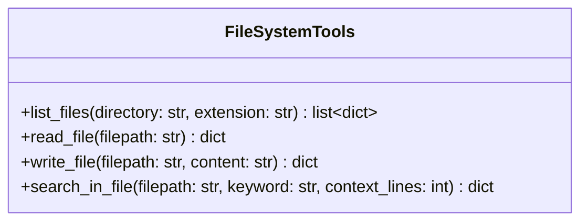

# 📚 API & Tool Specification Reference

This document provides complete, authoritative specifications for the core file system tools in `fs_tools.py` and the orchestration interfaces in `llm_file_assistant.py`.

---

## 1. Core Tool Suite (`fs_tools.py`)

All core tools return standardized Python dictionaries or lists conforming to predictable schemas.



---

### 1.1 `read_file`

Extracts full text and metadata from documents (**PDF**, **DOCX**, **TXT**, Markdown, and JSON).

#### Signature
```python
def read_file(filepath: str) -> dict[str, Any]
```

#### Input Parameters
| Parameter | Type | Required | Description | Example |
| :--- | :--- | :--- | :--- | :--- |
| `filepath` | `str` | Yes | Target path to the document to be parsed | `"resumes/resume_john_doe.pdf"` |

#### Return Value Schema
```json
{
  "success": true,
  "filepath": "C:/absolute/path/resumes/resume_john_doe.pdf",
  "filename": "resume_john_doe.pdf",
  "extension": ".pdf",
  "content": "John Doe\nSenior Python Backend Engineer...",
  "metadata": {
    "name": "resume_john_doe.pdf",
    "size": 2964,
    "size_bytes": 2964,
    "size_kb": 2.89,
    "modified_date": "2026-11-24 23:56:56",
    "modified_time": "2026-11-24 23:56:56",
    "format": "pdf",
    "page_count": 1,
    "word_count": 201,
    "character_count": 1420,
    "author": null,
    "title": null,
    "producer": "ReportLab PDF Library"
  },
  "error": null
}
```

#### Metadata Attributes by Document Type
- **PDF Documents (`.pdf`)**: `page_count`, `word_count`, `character_count`, `author`, `title`, `producer`.
- **DOCX Documents (`.docx`)**: `paragraph_count`, `table_count`, `word_count`, `character_count`, `author`, `title`.
- **Text Documents (`.txt`, `.md`, `.log`)**: `line_count`, `word_count`, `character_count`.

#### Error Schema
If the file does not exist, cannot be read, or is of an unsupported format:
```json
{
  "success": false,
  "filepath": "nonexistent.pdf",
  "filename": "nonexistent.pdf",
  "extension": ".pdf",
  "content": "",
  "metadata": {},
  "error": "File does not exist: 'nonexistent.pdf'"
}
```

---

### 1.2 `list_files`

Discovers all files in a target directory with metadata, with optional extension filtering.

#### Signature
```python
def list_files(directory: str, extension: Optional[str] = None) -> list[dict[str, Any]]
```

#### Input Parameters
| Parameter | Type | Required | Default | Description | Example |
| :--- | :--- | :--- | :--- | :--- | :--- |
| `directory` | `str` | Yes | - | Path to the directory to inspect | `"resumes"` or `"."` |
| `extension` | `str` | No | `None` | Optional extension filter (dot optional, case-insensitive) | `".pdf"`, `"docx"`, `"txt"` |

#### Return Value Schema
Returns a `list` of file metadata dictionaries:
```json
[
  {
    "name": "resume_john_doe.pdf",
    "size": 2964,
    "size_bytes": 2964,
    "size_kb": 2.89,
    "modified_date": "2026-11-24 23:56:56",
    "modified_time": "2026-11-24 23:56:56",
    "filepath": "C:/absolute/path/resumes/resume_john_doe.pdf",
    "extension": ".pdf"
  }
]
```

*Note: If the target directory does not exist or is inaccessible, `list_files` gracefully returns an empty list `[]`.*

---

### 1.3 `write_file`

Writes content to disk and automatically creates parent directories if they do not exist.

#### Signature
```python
def write_file(filepath: str, content: str) -> dict[str, Any]
```

#### Input Parameters
| Parameter | Type | Required | Description | Example |
| :--- | :--- | :--- | :--- | :--- |
| `filepath` | `str` | Yes | Output file path | `"summaries/summary_john_doe.txt"` |
| `content` | `str` | Yes | UTF-8 string content to write | `"Candidate Summary Report..."` |

#### Return Value Schema
```json
{
  "status": "success",
  "success": true,
  "filepath": "C:/absolute/path/summaries/summary_john_doe.txt",
  "filename": "summary_john_doe.txt",
  "bytes_written": 482,
  "message": "Successfully wrote 482 bytes to 'summary_john_doe.txt'",
  "error": null
}
```

#### Error Schema
```json
{
  "status": "failure",
  "success": false,
  "filepath": "protected/path.txt",
  "filename": "path.txt",
  "bytes_written": 0,
  "message": "Failed to write file 'path.txt'",
  "error": "PermissionError: [Errno 13] Permission denied"
}
```

---

### 1.4 `search_in_file`

Performs case-insensitive search across PDF, DOCX, or TXT documents and returns matches with surrounding line context.

#### Signature
```python
def search_in_file(
    filepath: str, 
    keyword: str, 
    context_lines: int = 1
) -> dict[str, Any]
```

#### Input Parameters
| Parameter | Type | Required | Default | Description | Example |
| :--- | :--- | :--- | :--- | :--- | :--- |
| `filepath` | `str` | Yes | - | Path to the target document | `"resumes/resume_john_doe.pdf"` |
| `keyword` | `str` | Yes | - | Term to search for (case-insensitive) | `"Python"`, `"FastAPI"` |
| `context_lines` | `int` | No | `1` | Lines before and after match to include | `1` or `2` |

#### Return Value Schema
```json
{
  "success": true,
  "filepath": "C:/absolute/path/resumes/resume_john_doe.pdf",
  "filename": "resume_john_doe.pdf",
  "keyword": "FastAPI",
  "matches_count": 2,
  "matches": [
    {
      "line_number": 6,
      "line_content": "Backend Architect with 8+ years developing microservices using Python, FastAPI, and PostgreSQL.",
      "line_text": "Backend Architect with 8+ years developing microservices using Python, FastAPI, and PostgreSQL.",
      "context": "EXPERIENCE SUMMARY\nBackend Architect with 8+ years developing microservices using Python, FastAPI, and PostgreSQL.\nLed cloud migration of high-throughput data pipelines."
    }
  ],
  "error": null
}
```

---

## 2. OpenAI Function Calling Tool Definitions (`TOOL_DEFINITIONS`)

The assistant registers tools with LLMs using the standard OpenAI specification:

```json
[
  {
    "type": "function",
    "function": {
      "name": "read_file",
      "description": "Read resume documents (PDF, DOCX, TXT) and extract text content along with file metadata (page count, size, modified date).",
      "parameters": {
        "type": "object",
        "properties": {
          "filepath": {
            "type": "string",
            "description": "The path to the file to read (e.g. 'resumes/resume_john_doe.pdf')."
          }
        },
        "required": ["filepath"]
      }
    }
  },
  {
    "type": "function",
    "function": {
      "name": "list_files",
      "description": "List all files in a directory, optionally filtered by extension (.pdf, .docx, .txt), and return file metadata such as name, size, and modified date.",
      "parameters": {
        "type": "object",
        "properties": {
          "directory": {
            "type": "string",
            "description": "The directory path to inspect (e.g. 'resumes' or '.')."
          },
          "extension": {
            "type": "string",
            "description": "Optional file extension filter, e.g. '.pdf', '.docx', '.txt'."
          }
        },
        "required": ["directory"]
      }
    }
  },
  {
    "type": "function",
    "function": {
      "name": "write_file",
      "description": "Write text content to a destination file. Automatically creates any parent directories if they do not already exist.",
      "parameters": {
        "type": "object",
        "properties": {
          "filepath": {
            "type": "string",
            "description": "Destination file path (e.g. 'summaries/summary_john_doe.txt')."
          },
          "content": {
            "type": "string",
            "description": "The text content to write into the file."
          }
        },
        "required": ["filepath", "content"]
      }
    }
  },
  {
    "type": "function",
    "function": {
      "name": "search_in_file",
      "description": "Search for keywords in a file's content (case-insensitive) across PDF, DOCX, or TXT. Returns matching lines with surrounding context.",
      "parameters": {
        "type": "object",
        "properties": {
          "filepath": {
            "type": "string",
            "description": "Path to the file to search within."
          },
          "keyword": {
            "type": "string",
            "description": "The keyword or phrase to search for (e.g. 'Python', 'AWS', 'Docker')."
          }
        },
        "required": ["filepath", "keyword"]
      }
    }
  }
]
```

---

## 3. LLM Assistant SDK Reference (`llm_file_assistant.py`)

### 3.1 `LLMFileAssistant`

Main orchestration class managing communication between the model, tool dispatcher, and conversation state.

#### Constructor Parameters
```python
assistant = LLMFileAssistant(
    provider="auto",        # "auto" | "openai" | "anthropic" | "groq" | "mock"
    api_key=None,           # Optional explicit API key override
    model=None,             # Model name (e.g., "gpt-4o-mini", "llama-3.3-70b-versatile")
    base_url=None,          # Custom API base URL for Ollama / vLLM
    verbose=True            # Toggle execution trace logging to console
)
```

#### Primary Method: `run`
```python
def run(
    self, 
    query: str, 
    conversation_history: Optional[list[dict[str, Any]]] = None,
    max_iterations: int = 10
) -> dict[str, Any]
```

#### Method Return Format
```python
{
    "query": "Create a summary file for resume_john_doe.pdf",
    "response": "I have successfully created a summary file...",
    "tool_calls_executed": [
        {
            "tool": "read_file",
            "arguments": {"filepath": "resumes/resume_john_doe.pdf"},
            "result": {"success": True, ...}
        },
        {
            "tool": "write_file",
            "arguments": {"filepath": "summaries/summary_john_doe.txt", "content": "..."},
            "result": {"status": "success", ...}
        }
    ],
    "iterations": 2,
    "provider": "openai",
    "model": "gpt-4o-mini"
}
```

---

## 4. CLI Argument Reference

```bash
python llm_file_assistant.py [QUERY...] [OPTIONS]
```

| Flag | Short | Default | Description |
| :--- | :--- | :--- | :--- |
| `QUERY` | - | None | Positional natural language query string to execute |
| `--interactive` | `-i` | `False` | Launch interactive terminal REPL conversation loop |
| `--serve` | - | `False` | Launch HTTP API server exposing `GET /health` and `POST /query` |
| `--host` | - | `127.0.0.1` | Bind host address for `--serve` mode (override with `ASSISTANT_HOST`) |
| `--port` | - | `8000` | Bind port for `--serve` mode (override with `PORT`) |
| `--provider` | `-p` | `"auto"` | Select LLM backend: `auto`, `openai`, `anthropic`, `groq`, `mock` |
| `--model` | `-m` | Auto-detected | Override model name (e.g. `gpt-4o-mini`, `claude-3-5-sonnet-latest`) |
| `--quiet` | `-q` | `False` | Suppress `[Tool Call]` and `[Tool Result]` execution logs |

---

## 5. HTTP Server Endpoints (`--serve` Mode)

When running `python llm_file_assistant.py --serve --host 0.0.0.0 --port 8000`:

- **`GET /` or `GET /health`**: Returns `200 OK` JSON `{"status": "healthy", "service": "llm-file-system-assistant", "provider": "...", "model": "..."}`.
- **`POST /query`**: Accepts JSON `{"query": "..."}` and returns `200 OK` with the full `LLMFileAssistant.run()` JSON payload (`400` on invalid/empty input).
