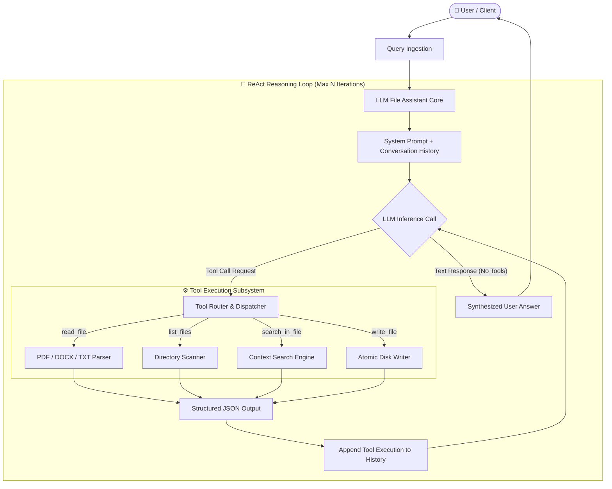
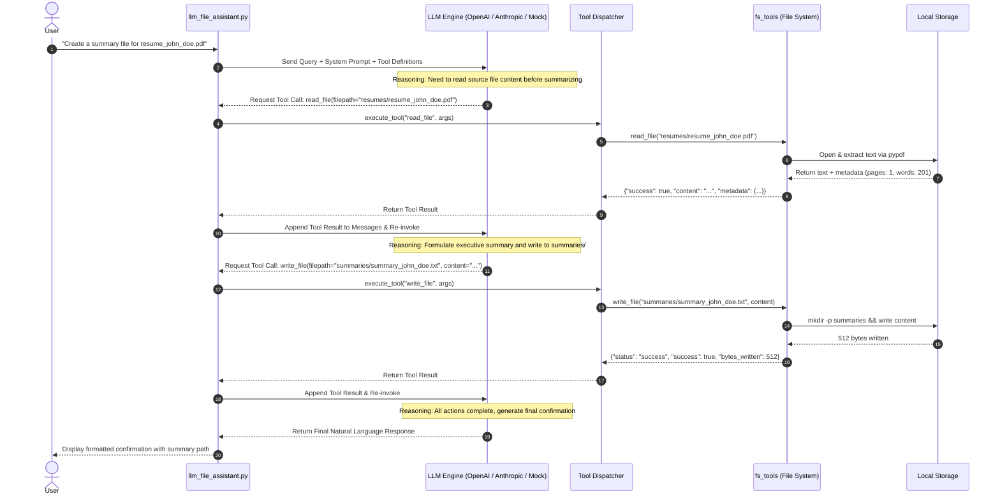
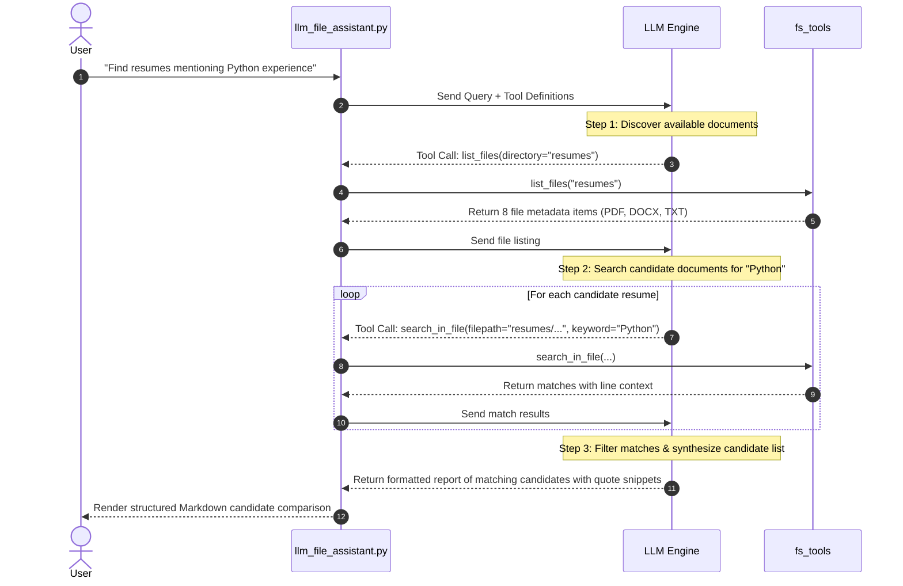

# 🏛️ Architecture & System Design

This document details the architectural blueprint, component design, data flow, and runtime mechanics of the **LLM-Powered File System Assistant**.

---

## 1. High-Level Architecture Overview

The system bridges unstructured natural language instructions and deterministic file system operations through an autonomous **Reasoning-Action (ReAct) loop** utilizing standard LLM function calling.



---

## 2. Core System Components

The architecture is cleanly decoupled into five modular layers:

### 2.1 Interface & Presentation Layer
- **CLI Direct Execution** (`python llm_file_assistant.py "<query>"`): Parses CLI arguments, passes single-turn instructions, and formats terminal markdown output.
- **Interactive REPL** (`python llm_file_assistant.py --interactive`): Maintains a conversational multi-turn session across sequential user queries.
- **HTTP API Server** (`python llm_file_assistant.py --serve --port 8000`): Exposes `GET /health` (used by Docker/ALB health checks) and `POST /query` JSON endpoints via Python's built-in `ThreadingHTTPServer`.
- **Guided Demonstration Harness** (`demo.py`): Provides structured evaluation walkthroughs with automated delays, step-by-step pauses, and visual output verification.

### 2.2 Orchestration Engine (`llm_file_assistant.py`)
- **`LLMFileAssistant`**: Main engine coordinating system prompts, provider selection, conversational message history, tool dispatching, and iteration safety limits.
- **Iteration Guard**: Enforces an upper limit (default: 10 iterations) to guarantee execution termination and prevent unbounded API costs or cycling loops.
- **`MockLLMEngine`**: Deterministic offline evaluation engine that emulates tool invocation decisions without requiring external network connectivity or API credentials.

### 2.3 Provider Abstraction Layer
Provides a uniform abstraction across multiple frontier model APIs:
- **OpenAI**: Native function calling utilizing `gpt-4o-mini`, `gpt-4o`, and JSON schema tool definitions.
- **Anthropic**: Messages API tool use utilizing `claude-3-5-sonnet-latest` and input schema normalization.
- **Groq**: High-throughput inference leveraging `llama-3.3-70b-versatile` over OpenAI-compatible endpoints.
- **OpenAI-Compatible Local Endpoints**: Supports local models via Ollama, vLLM, or LM Studio via `OPENAI_BASE_URL`.
- **Automatic Fallback Circuit**: In the event of missing credentials or remote API network anomalies, the engine seamlessly routes execution to the deterministic mock engine.

### 2.4 Tool Execution Subsystem (`fs_tools.py`)
Standardized Python routines exposed to the LLM via JSON schema:
1. `list_files`: Non-recursive directory scanner with extension filtering and metadata harvesting.
2. `read_file`: Multi-format text extraction engine supporting PDF, DOCX, and plain text formats.
3. `search_in_file`: Case-insensitive line-level string matcher with surrounding sliding context extraction.
4. `write_file`: Atomic text writer with automated parent directory creation and status reporting.

### 2.5 Storage Subsystem
- **Local Storage**: Filesystem workspace paths (`resumes/`, `summaries/`).
- **Cloud Object Storage**: S3-compatible bucket hierarchy for scalable cloud deployments.

---

## 3. Tool Calling Sequence Diagrams

### 3.1 Multi-Step Summarization Sequence (`Query 3`)
This diagram shows the complete lifecycle of creating a summary file from an input resume document:



---

### 3.2 Skill-Based Candidate Matching Sequence (`Query 2`)
This diagram illustrates autonomous discovery and filtering across multiple documents:



---

## 4. Multi-Format Document Parsing Pipeline

The `read_file` tool routes parsing based on file extension while ensuring uniform schema outputs:

```mermaid
flowchart TD
    In[Target File Path] --> PathCheck{Path Exists & Is File?}
    PathCheck -->|No| ErrRet[Return Error Dictionary: success=False]
    PathCheck -->|Yes| Stat[Stat Metadata: size, modified_date]
    
    Stat --> ExtBranch{File Extension?}
    
    ExtBranch -->|".pdf"| PDFParser[pypdf PdfReader]
    ExtBranch -->|".docx"| DOCXParser[python-docx Document]
    ExtBranch -->|".txt / .md / .json"| TXTParser[Multi-Encoding Text Reader]
    ExtBranch -->|Unknown| FallbackParser[Fallback Plain Text Reader]
    
    PDFParser --> PageLoop[Iterate Pages & Extract Text]
    PageLoop --> PDFMeta[Extract Page Count & PDF Metadata]
    
    DOCXParser --> ParaLoop[Extract Paragraphs]
    DOCXParser --> TableLoop[Extract Table Rows & Cells]
    ParaLoop & TableLoop --> DOCXMeta[Extract Paragraph/Table Counts & Author]
    
    TXTParser --> EncLoop{Try Encodings:\nUTF-8, UTF-8-SIG, Latin-1, CP1252}
    EncLoop --> TXTMeta[Calculate Line, Word, and Character Counts]
    
    PDFMeta & DOCXMeta & TXTMeta --> SchemaNormalizer[Standardized Result Schema]
    SchemaNormalizer --> Out[{"success": true, "content": "...", "metadata": {...}}]
```

---

## 5. Security & Boundary Architecture

To safeguard host environments against unauthorized access and tampering, the assistant enforces rigorous boundary controls:

1. **Path Resolution & Normalization**:
   All paths passed to `fs_tools` are resolved through `pathlib.Path(filepath).resolve()`, preventing directory traversal exploits (e.g., `../../etc/passwd`).
2. **Read-Only Inspection Guarantees**:
   The `read_file`, `list_files`, and `search_in_file` tools operate strictly in read-only mode, opening file handles with flags that preclude modification.
3. **Controlled Write Boundaries**:
   The `write_file` tool creates missing directories exclusively within the target output tree and commits content in UTF-8. In cloud production deployments, this is constrained to dedicated S3 bucket prefixes or ephemeral local scratch storage.
4. **Resilient Failure Boundaries**:
   File system anomalies (such as permissions errors, missing files, or corrupted archives) are caught within tool try-except blocks and returned as structured JSON error responses rather than throwing uncaught Python exceptions. This allows the LLM to inspect the failure and gracefully recover or inform the user.
