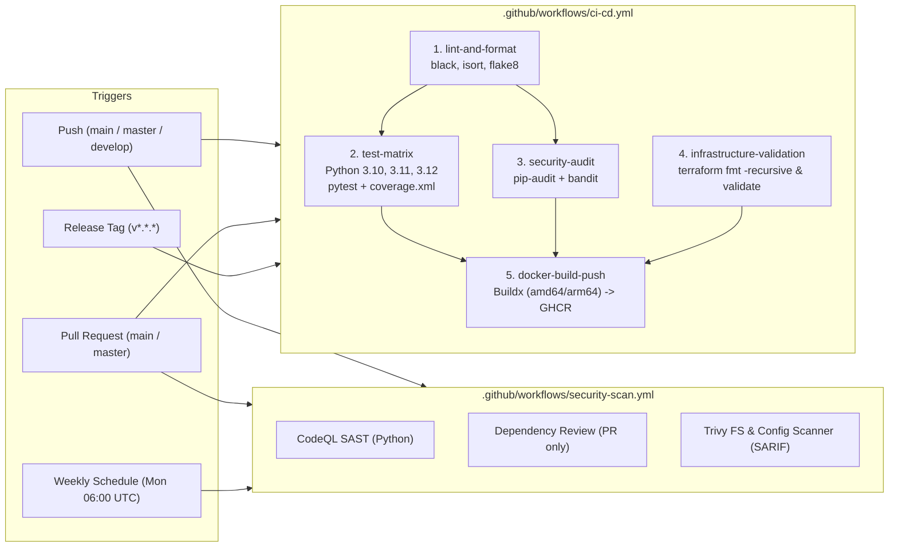

# 🚀 CI/CD Pipeline & DevOps Automation

This document describes the automated Continuous Integration and Security pipelines configured under `.github/workflows/` for the **LLM-Powered File System Assistant**.

---

## 1. Pipeline Architecture Diagram



---

## 2. Workflow Breakdown

### 2.1 Main CI/CD Pipeline (`.github/workflows/ci-cd.yml`)

| Job | Runner | Tools & Actions | Failure Condition |
| :--- | :--- | :--- | :--- |
| **`lint-and-format`** | `ubuntu-latest` | `black --check --diff .`, `isort --check-only --diff .`, `flake8` | Formatting drift, import disorder, syntax errors, or complexity $> 15$ |
| **`test-matrix`** | `ubuntu-latest` | `pytest --cov=. --cov-report=xml` across Python `3.10`, `3.11`, `3.12` | Any failing test case in `tests/` (27 total) |
| **`security-audit`** | `ubuntu-latest` | `pip-audit -r requirements.txt`, `bandit -r . -x ./tests,./.venv,./venv -ll` | Known dependency CVEs or Medium/High Bandit SAST findings |
| **`infrastructure-validation`** | `ubuntu-latest` | `hashicorp/setup-terraform@v3` (`1.9.8`), `terraform fmt -check -diff -recursive infra/`, `terraform -chdir=infra/terraform init -backend=false`, `validate` | HCL formatting drift or invalid Terraform module references |
| **`docker-build-push`** | `ubuntu-latest` | `docker/setup-qemu-action@v3`, `docker/setup-buildx-action@v3`, `docker/metadata-action@v5`, `docker/login-action@v3`, `docker/build-push-action@v6` | Multi-stage Docker build error; pushes to `ghcr.io/${{ github.repository }}` on `main` or `v*.*.*` tags |

---

### 2.2 Security & CodeQL Scanning (`.github/workflows/security-scan.yml`)

| Job | Trigger | Tools & Actions | Output / Integration |
| :--- | :--- | :--- | :--- |
| **`codeql-analysis`** | Push, PR, Weekly Cron | `github/codeql-action/init@v3` & `analyze@v3` (`security-extended,security-and-quality`) | Uploads Python SAST findings to GitHub Security tab |
| **`dependency-review`** | Pull Request | `actions/dependency-review-action@v4` (`fail-on-severity: high`) | Blocks PRs introducing High/Critical dependency vulnerabilities |
| **`trivy-scan`** | Push, PR, Weekly Cron | `aquasecurity/trivy-action@v0.36.0` (`scan-type: fs`, `severity: CRITICAL,HIGH`) + `upload-sarif@v3` | Scans filesystem, Dockerfile, and Terraform configs; uploads `trivy-results.sarif` |

---

## 3. Caching & Optimization Strategy

1. **Python Pip Caching**:
   - `actions/setup-python@v5` with `cache: 'pip'` caches downloaded wheels keyed by `requirements.txt`.
2. **Docker Buildx Layer Caching**:
   - `cache-from: type=gha` and `cache-to: type=gha,mode=max` persist intermediate `python:3.12-slim` virtual environment layers across workflow runs.
3. **Concurrency Control**:
   - In-progress PR runs on the same branch are automatically cancelled (`cancel-in-progress: ${{ github.event_name == 'pull_request' }}`) to avoid wasted runner minutes.

---

## 4. Running CI Checks Locally Before Pushing

```bash
# 1. Format & Lint
isort . && black .
flake8 . --count --max-complexity=15 --max-line-length=127 --statistics

# 2. Tests & Coverage
pytest --cov=. --cov-report=term-missing tests/

# 3. Security Scans
bandit -r . -x ./tests,./.venv,./venv -ll
pip-audit -r requirements.txt

# 4. Terraform Validation
terraform fmt -check -diff -recursive infra/
terraform -chdir=infra/terraform init -backend=false
terraform -chdir=infra/terraform validate
```
