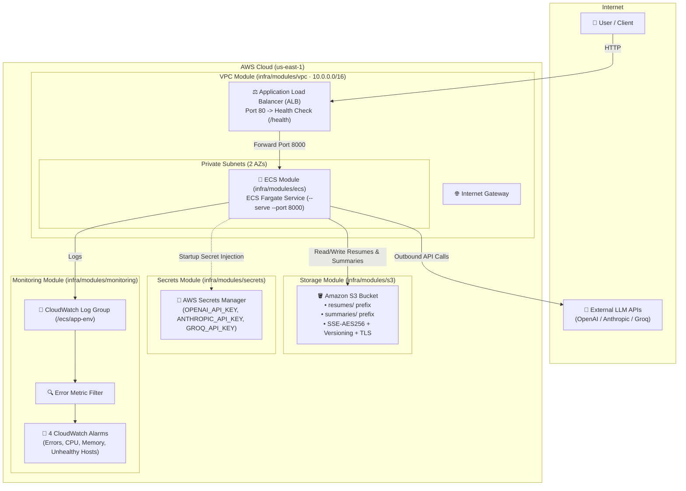

# 🏗️ Infrastructure as Code (IaC) & Cloud Architecture

This document specifies the modular AWS cloud infrastructure for hosting the **LLM-Powered File System Assistant** using **Terraform** (`infra/modules/` and `infra/terraform/`). It covers networking, S3 object storage, Secrets Manager integration, ECS Fargate compute, IAM least-privilege roles, and CloudWatch monitoring.

---

## 1. Cloud Reference Topology



---

## 2. Modular Directory Layout

All AWS infrastructure resources are isolated into reusable modules under `infra/modules/` and composed in `infra/terraform/`:

```
infra/
├── modules/
│   ├── vpc/            # VPC, multi-AZ public & private subnets, IGW, optional NAT GW, ALB/ECS security groups
│   ├── s3/             # S3 bucket, SSE-AES256 encryption, versioning, public access block, lifecycle, TLS policy
│   ├── secrets/        # Secrets Manager secret & template version (ignore_changes on secret_string)
│   ├── ecs/            # CloudWatch log group, ECS cluster, Fargate task definition, ALB/TG/listener, IAM roles
│   └── monitoring/     # Log metric filter + CloudWatch alarms (error spike, CPU, memory, unhealthy targets)
└── terraform/
    ├── main.tf         # Module invocations & cross-module wiring
    ├── variables.tf    # Strongly-typed variables with validation rules
    ├── outputs.tf      # Exported ARNs, endpoints, bucket names, log group name
    ├── backend.tf      # Remote S3 + DynamoDB state locking instructions
    ├── terraform.tfvars.example
    └── TERRAFORM_GUIDE.md
```

---

## 3. Module Specifications

### 3.1 `infra/modules/vpc`
- Provisions a `/16` VPC with DNS hostnames enabled, two public subnets (ALB), and two private subnets (ECS Fargate tasks).
- Includes an Internet Gateway for public traffic and a conditional NAT Gateway (`enable_nat_gateway = true` for production, `false` for cost-efficient dev).
- Isolates ECS tasks with a dedicated security group (`ecs-sg`) that accepts inbound traffic on `var.container_port` (default `8000`) **only** from the ALB security group (`alb-sg`).

### 3.2 `infra/modules/s3`
- Creates a uniquely suffixed bucket (`${var.bucket_prefix}-${var.environment}-<hex>`).
- Pre-creates `resumes/` and `summaries/` folder prefixes.
- **Security Controls**:
  - `AES256` server-side encryption with bucket key enabled.
  - All 4 S3 Public Access Block flags enforced (`true`) and `BucketOwnerEnforced` ownership controls.
  - Bucket policy explicitly denies non-HTTPS requests (`aws:SecureTransport = "false"`).
- **Lifecycle**: Transitions objects to `STANDARD_IA` after 30 days, `GLACIER` after 90 days, and expires noncurrent versions after 60 days.

### 3.3 `infra/modules/secrets`
- Provisions `${var.app_name}-${var.environment}-llm-api-keys` in AWS Secrets Manager for `OPENAI_API_KEY`, `ANTHROPIC_API_KEY`, and `GROQ_API_KEY`.
- Uses `lifecycle { ignore_changes = [secret_string] }` so manual/out-of-band key rotations are never overwritten by Terraform runs.

### 3.4 `infra/modules/ecs`
- Creates the CloudWatch Log Group `/ecs/${var.app_name}-${var.environment}` prior to service startup so `awslogs` never races on container boot.
- Configures an ECS Cluster with **Container Insights** enabled.
- Launches Fargate tasks executing `["--serve", "--host", "0.0.0.0", "--port", "<container_port>"]` behind an Application Load Balancer health checking `/health`.
- Enforces **Least-Privilege IAM**:
  - **Execution Role**: `AmazonECSTaskExecutionRolePolicy` + `secretsmanager:GetSecretValue` scoped strictly to the module's secret ARN.
  - **Task Role**: `s3:GetObject`, `s3:PutObject`, `s3:ListBucket` scoped strictly to the module's S3 bucket ARN.

### 3.5 `infra/modules/monitoring`
- Attaches an `aws_cloudwatch_log_metric_filter` scanning container logs for `?ERROR ?CRITICAL ?Exception ?failed`.
- Provisions 4 CloudWatch Metric Alarms:
  1. **Error Spike**: Triggers when `ApplicationErrorCount` exceeds `var.alarm_error_count_threshold` (default `5`).
  2. **ECS High CPU**: Triggers when average CPU exceeds `var.alarm_cpu_threshold` (default `80%`).
  3. **ECS High Memory**: Triggers when average memory exceeds `var.alarm_memory_threshold` (default `80%`).
  4. **ALB Unhealthy Hosts**: Triggers when `UnHealthyHostCount > 0`.

---

## 4. Validation & Provisioning Commands

```bash
# Check formatting across all modules and root config
terraform fmt -check -diff -recursive infra/

# Initialize without remote backend (for CI validation)
terraform -chdir=infra/terraform init -backend=false

# Validate all module references and variable types
terraform -chdir=infra/terraform validate
```

For full deployment steps, see [`infra/terraform/TERRAFORM_GUIDE.md`](../infra/terraform/TERRAFORM_GUIDE.md).
