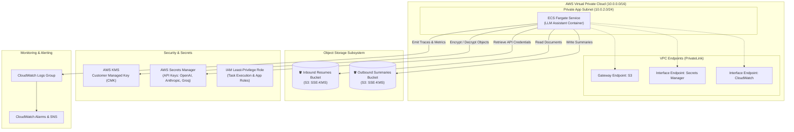

# 🏗️ Infrastructure as Code (IaC) & Cloud Architecture

This document specifies the enterprise cloud infrastructure for hosting the **LLM-Powered File System Assistant** on Amazon Web Services (AWS) using **Terraform**. It details object storage architectures, secrets lifecycle management, least-privilege IAM security controls, and observability frameworks.

---

## 1. Cloud Reference Topology



---

## 2. Storage Architecture: S3 Buckets & Lifecycle Policies

In enterprise cloud deployments, local filesystem paths (`resumes/` and `summaries/`) map to isolated S3 object stores.

### 2.1 Dual-Bucket Segmentation
1. **Inbound Storage (`resumes-inbound-${var.environment}`)**:
   - Holds ingested candidate resumes in raw PDF, DOCX, and TXT formats.
   - Enforces read-only permissions for the runtime assistant task.
2. **Outbound Storage (`summaries-outbound-${var.environment}`)**:
   - Holds generated candidate evaluations, structured reports, and summaries.
   - Writable by the assistant container; immutable to external tenants.

### 2.2 Security Controls & Compliance
- **Server-Side Encryption**: Enforced with dedicated AWS KMS Customer Managed Keys (CMK).
- **Transport Security**: Bucket policies explicitly deny non-HTTPS transactions via condition `aws:SecureTransport = false`.
- **Public Access Prevention**: All four public access block settings (`BlockPublicAcls`, `IgnorePublicAcls`, `BlockPublicPolicy`, `RestrictPublicBuckets`) are strictly enabled.
- **Object Versioning**: Enabled on all buckets to prevent accidental deletion and preserve audit histories.

---

## 3. Terraform Infrastructure Specifications

Below is the complete, modular Terraform implementation ready for provisioning.

### 3.1 `variables.tf`
```hcl
variable "aws_region" {
  description = "Target AWS deployment region"
  type        = string
  default     = "us-east-1"
}

variable "environment" {
  description = "Deployment environment tier (dev, staging, prod)"
  type        = string
  default     = "prod"
}

variable "project_name" {
  description = "Project identifier used in naming conventions"
  type        = string
  default     = "llm-fs-assistant"
}
```

### 3.2 `kms.tf` (Encryption at Rest)
```hcl
resource "aws_kms_key" "app_storage_key" {
  description             = "KMS CMK for LLM File Assistant S3 and Secrets encryption"
  deletion_window_in_days = 30
  enable_key_rotation     = true

  tags = {
    Project     = var.project_name
    Environment = var.environment
  }
}

resource "aws_kms_alias" "app_storage_key_alias" {
  name          = "alias/${var.project_name}-${var.environment}-key"
  target_key_id = aws_kms_key.app_storage_key.key_id
}
```

### 3.3 `s3.tf` (Storage Buckets & Lifecycle)
```hcl
# 1. Inbound Documents Bucket (Resumes)
resource "aws_s3_bucket" "resumes_bucket" {
  bucket = "${var.project_name}-resumes-${var.environment}"

  tags = {
    Project     = var.project_name
    Environment = var.environment
  }
}

resource "aws_s3_bucket_versioning" "resumes_versioning" {
  bucket = aws_s3_bucket.resumes_bucket.id
  versioning_configuration {
    status = "Enabled"
  }
}

resource "aws_s3_bucket_server_side_encryption_configuration" "resumes_encryption" {
  bucket = aws_s3_bucket.resumes_bucket.id

  rule {
    apply_server_side_encryption_by_default {
      kms_master_key_id = aws_kms_key.app_storage_key.arn
      sse_algorithm     = "aws:kms"
    }
  }
}

resource "aws_s3_bucket_public_access_block" "resumes_pab" {
  bucket                  = aws_s3_bucket.resumes_bucket.id
  block_public_acls       = true
  ignore_public_acls      = true
  block_public_policy     = true
  restrict_public_buckets = true
}

# 2. Outbound Summaries Bucket
resource "aws_s3_bucket" "summaries_bucket" {
  bucket = "${var.project_name}-summaries-${var.environment}"

  tags = {
    Project     = var.project_name
    Environment = var.environment
  }
}

resource "aws_s3_bucket_versioning" "summaries_versioning" {
  bucket = aws_s3_bucket.summaries_bucket.id
  versioning_configuration {
    status = "Enabled"
  }
}

resource "aws_s3_bucket_server_side_encryption_configuration" "summaries_encryption" {
  bucket = aws_s3_bucket.summaries_bucket.id

  rule {
    apply_server_side_encryption_by_default {
      kms_master_key_id = aws_kms_key.app_storage_key.arn
      sse_algorithm     = "aws:kms"
    }
  }
}

resource "aws_s3_bucket_public_access_block" "summaries_pab" {
  bucket                  = aws_s3_bucket.summaries_bucket.id
  block_public_acls       = true
  ignore_public_acls      = true
  block_public_policy     = true
  restrict_public_buckets = true
}

# S3 Lifecycle Policy: Transition after 30 days, archive to Glacier after 90 days
resource "aws_s3_bucket_lifecycle_configuration" "summaries_lifecycle" {
  bucket = aws_s3_bucket.summaries_bucket.id

  rule {
    id     = "archive-old-summaries"
    status = "Enabled"

    transition {
      days          = 30
      storage_class = "STANDARD_IA"
    }

    transition {
      days          = 90
      storage_class = "GLACIER"
    }

    expiration {
      days = 365
    }
  }
}
```

### 3.4 `iam.tf` (Least-Privilege Security Roles)
```hcl
# ECS Task Role (Runtime permissions granted to the container application)
resource "aws_iam_role" "ecs_task_role" {
  name = "${var.project_name}-task-role-${var.environment}"

  assume_role_policy = jsonencode({
    Version = "2012-10-17"
    Statement = [
      {
        Action = "sts:AssumeRole"
        Effect = "Allow"
        Principal = {
          Service = "ecs-tasks.amazonaws.com"
        }
      }
    ]
  })
}

# Granular Task Policy: Read from resumes, write to summaries, decrypt KMS
resource "aws_iam_policy" "ecs_task_policy" {
  name        = "${var.project_name}-task-policy-${var.environment}"
  description = "Least-privilege policy for LLM File Assistant task"

  policy = jsonencode({
    Version = "2012-10-17"
    Statement = [
      {
        Sid    = "AllowInboundResumesRead"
        Effect = "Allow"
        Action = [
          "s3:GetObject",
          "s3:ListBucket"
        ]
        Resource = [
          aws_s3_bucket.resumes_bucket.arn,
          "${aws_s3_bucket.resumes_bucket.arn}/*"
        ]
      },
      {
        Sid    = "AllowOutboundSummariesWrite"
        Effect = "Allow"
        Action = [
          "s3:PutObject",
          "s3:GetObject",
          "s3:ListBucket"
        ]
        Resource = [
          aws_s3_bucket.summaries_bucket.arn,
          "${aws_s3_bucket.summaries_bucket.arn}/*"
        ]
      },
      {
        Sid    = "AllowKMSEncryptionDecryption"
        Effect = "Allow"
        Action = [
          "kms:Decrypt",
          "kms:GenerateDataKey"
        ]
        Resource = [
          aws_kms_key.app_storage_key.arn
        ]
      }
    ]
  })
}

resource "aws_iam_role_policy_attachment" "task_policy_attach" {
  role       = aws_iam_role.ecs_task_role.name
  policy_arn = aws_iam_policy.ecs_task_policy.arn
}
```

### 3.5 `secrets.tf` (Secrets Management)
```hcl
resource "aws_secretsmanager_secret" "llm_credentials" {
  name                    = "${var.project_name}/llm-keys-${var.environment}"
  description             = "API keys for LLM providers (OpenAI, Anthropic, Groq)"
  kms_key_id              = aws_kms_key.app_storage_key.arn
  recovery_window_in_days = 7
}

# Policy allowing ECS Task Execution Role to resolve secrets at container boot
resource "aws_iam_policy" "secrets_read_policy" {
  name = "${var.project_name}-secrets-read-${var.environment}"

  policy = jsonencode({
    Version = "2012-10-17"
    Statement = [
      {
        Effect   = "Allow"
        Action   = ["secretsmanager:GetSecretValue"]
        Resource = [aws_secretsmanager_secret.llm_credentials.arn]
      }
    ]
  })
}
```

---

## 4. Monitoring, Observability & Alerting

### 4.1 CloudWatch Metric Thresholds

| Metric Name | Threshold | Evaluation Period | Action |
| :--- | :--- | :--- | :--- |
| **AssistantExecutionErrors** | $> 3$ errors in 5 min | 1 minute | PagerDuty / SNS Alert |
| **ToolExecutionDuration** | $p95 > 2.5\text{s}$ | 5 minutes | Slack Ops Warning |
| **MaxIterationsReached** | $\ge 1$ occurrence | Immediate | Engineering Investigation |
| **TokenBudgetExceeded** | $\ge \$50$ daily burn | Daily | Cost Notification Alert |

### 4.2 Logging Configuration
The assistant writes structured JSON logs to AWS CloudWatch with correlation IDs:
```json
{
  "timestamp": "2026-11-25T00:15:20.104Z",
  "level": "INFO",
  "correlation_id": "req-8f43c1a9-3d1b",
  "component": "LLMFileAssistant",
  "provider": "openai",
  "model": "gpt-4o-mini",
  "query": "Create a summary file for resume_john_doe.pdf",
  "tools_invoked": ["read_file", "write_file"],
  "duration_ms": 1420,
  "status": "COMPLETED"
}
```
