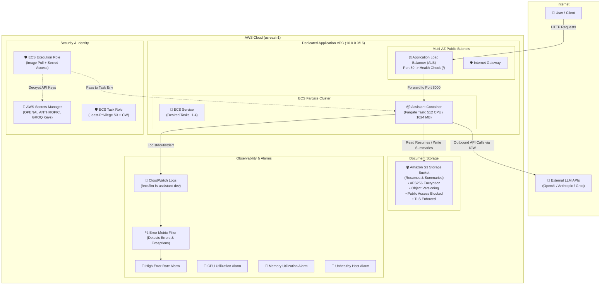

# ☁️ Infrastructure as Code (IaC) - LLM File System Assistant

Production-ready, enterprise-grade Terraform configurations for deploying the **LLM-Powered File System Assistant** on Amazon Web Services (AWS).

---

## 🏛️ Architecture Overview



---

## 📦 Provisioned Resources

| Component | AWS Resource | Description |
| :--- | :--- | :--- |
| **Storage** | `aws_s3_bucket` | Dedicated bucket for resume documents and generated summaries |
| | `aws_s3_bucket_versioning` | Enabled object versioning for audit trail and history |
| | `aws_s3_bucket_server_side_encryption_configuration` | AES-256 Server-Side Encryption with bucket key enabled |
| | `aws_s3_bucket_public_access_block` | Complete public access block (100% private) |
| | `aws_s3_bucket_lifecycle_configuration` | Automatic transition of older versions to Standard-IA (30d) and Glacier (90d) |
| | `aws_s3_bucket_policy` | TLS/HTTPS enforcement (denies unencrypted requests) |
| **Secrets Management** | `aws_secretsmanager_secret` | Stores `OPENAI_API_KEY`, `ANTHROPIC_API_KEY`, and `GROQ_API_KEY` |
| | `aws_secretsmanager_secret_version` | Initial template with `lifecycle { ignore_changes = [secret_string] }` |
| **Networking** | `aws_vpc` | Dedicated VPC (10.0.0.0/16) with DNS hostnames and support |
| | `aws_subnet` | Multi-AZ Public and Private subnets across available zones |
| | `aws_internet_gateway` | Ingress and egress internet gateway |
| | `aws_security_group` | Ingress-restricted ALB and container isolation security groups |
| **Compute** | `aws_ecs_cluster` | ECS Cluster with CloudWatch Container Insights enabled |
| | `aws_ecs_task_definition` | Fargate task definition with configurable CPU/Memory and Secrets injection |
| | `aws_ecs_service` | Fargate service with zero-downtime rolling deployments (100% min, 200% max) |
| | `aws_lb` & `aws_lb_target_group` | Application Load Balancer with HTTP health checking |
| **IAM** | `aws_iam_role` (Execution) | Least-privilege role for ECS agent to pull container and fetch secrets |
| | `aws_iam_role` (Task) | Least-privilege role granting S3 bucket actions (`GetObject`, `PutObject`, `ListBucket`) |
| **Monitoring** | `aws_cloudwatch_log_group` | Centralized structured logging with configurable retention |
| | `aws_cloudwatch_log_metric_filter`| Pattern filter detecting application errors and exceptions |
| | `aws_cloudwatch_metric_alarm` | 4 proactive alarms (High Errors, High CPU, High Memory, Unhealthy Hosts) |

---

## 🚀 Deployment Instructions

### 1. Prerequisites
- [Terraform](https://www.terraform.io/) >= 1.5.0 installed.
- [AWS CLI](https://aws.amazon.com/cli/) configured with valid administrative credentials (`aws sts get-caller-identity`).

### 2. Configure Variables
Copy the example configuration:
```bash
cd infra/terraform
cp terraform.tfvars.example terraform.tfvars
```
Edit `terraform.tfvars` with your AWS settings (e.g. AWS region, container image, environment).

### 3. Initialize & Validate Terraform
```bash
# Initialize providers (AWS provider >= 5.0)
terraform init

# Validate syntax and configuration schema
terraform validate

# Format HCL code
terraform fmt
```

### 4. Review Execution Plan
```bash
terraform plan -out=tfplan
```

### 5. Apply Infrastructure
```bash
terraform apply tfplan
```

### 6. Populate Real LLM API Keys
After provisioning, set your actual production LLM keys in AWS Secrets Manager:
```bash
aws secretsmanager put-secret-value \
  --secret-id "llm-fs-assistant/dev/llm-api-keys" \
  --secret-string '{"OPENAI_API_KEY":"sk-...","ANTHROPIC_API_KEY":"sk-ant-...","GROQ_API_KEY":"gsk_..."}'
```

---

## 🔒 Security & Best Practices

1. **Least Privilege IAM**: The ECS container task role cannot modify AWS IAM or access unauthorized buckets. It is scoped strictly to the assistant's S3 bucket.
2. **Secrets Decoupling**: API keys are never stored in code, Git, or plain text environment variables. They are injected at container startup via AWS Secrets Manager.
3. **Data Protection at Rest & In-Transit**:
   - S3 SSE-AES256 with bucket keys minimizes KMS overhead while ensuring complete encryption at rest.
   - S3 bucket policy enforces `aws:SecureTransport = "true"`, rejecting unencrypted HTTP calls.
4. **Network Isolation**: The ECS tasks accept inbound connections *only* from the ALB security group, rejecting direct internet probing.
5. **Proactive Observability**: High error rates or unhealthy container instances automatically trigger CloudWatch Alarms.
